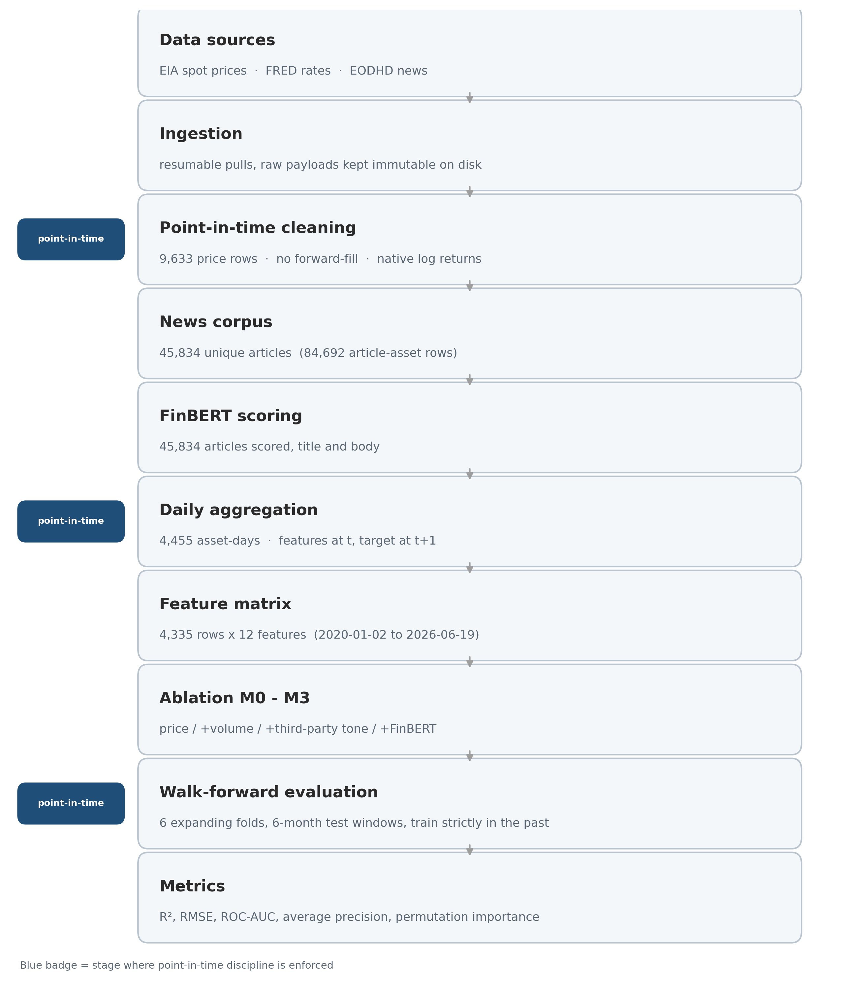
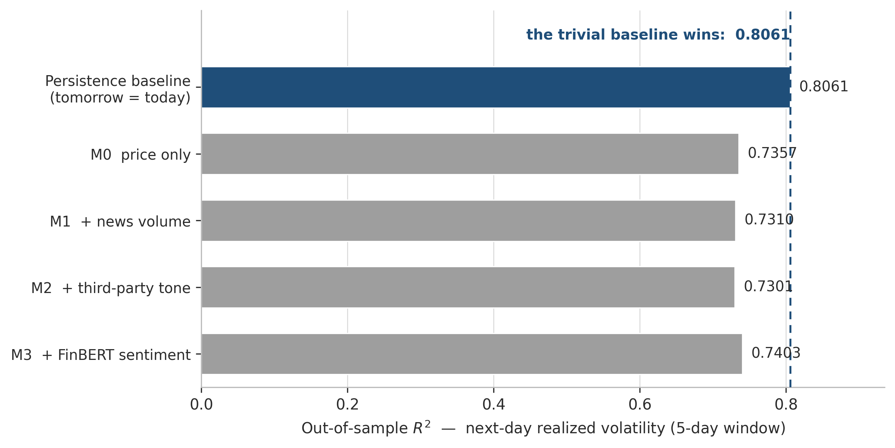
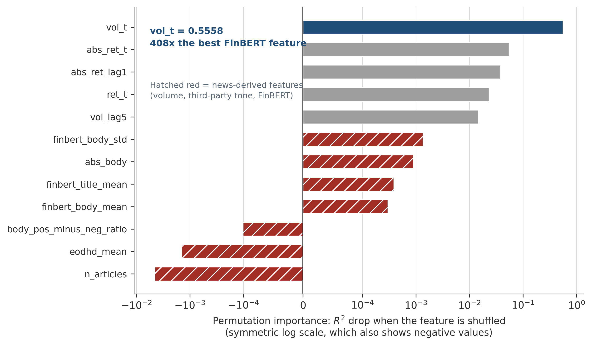
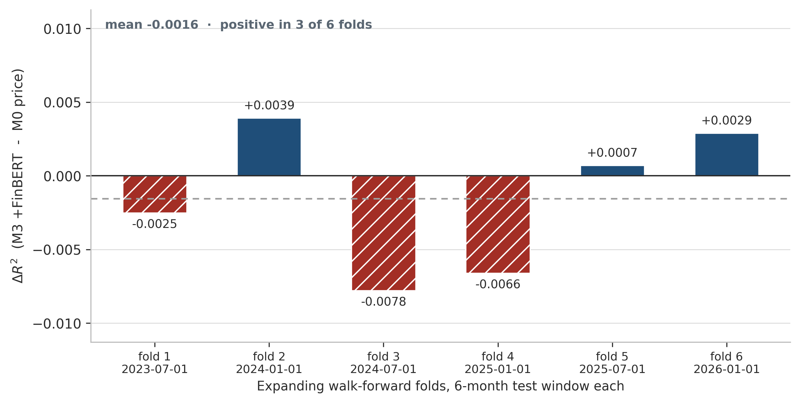
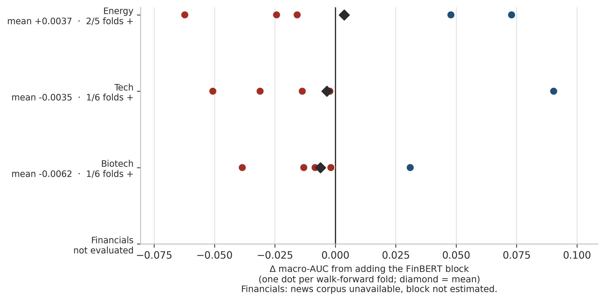

# Testing whether news sentiment forecasts volatility: a negative result

## Result

I tested whether news sentiment, measured with FinBERT, improves next-day volatility forecasts
beyond what price history already provides. It does not, and three numbers carry the finding.

A persistence baseline — tomorrow's realized volatility equals today's — scores an out-of-sample
R² of **0.8061**. The best model that includes sentiment scores **0.7403**. In permutation
importance, five-day realized volatility is worth **0.5558** and the strongest FinBERT feature is
worth **0.0014**: a factor of 408. Across six expanding walk-forward folds, adding the FinBERT
block changes R² by **−0.0016** on average and helps in **three of six** folds.

I then tried to break that conclusion in three more asset universes. It held.

## Why the hypothesis was reasonable

Volatility responds to information arrival, and news is the cheapest high-frequency proxy for it.
Antweiler and Frank (2004) found that message-board text predicts volatility, with a significant
but economically small effect on returns. FinBERT reads financial prose, and a non-linear model
should recover what simple correlations miss. The reasoning is sound. It is also wrong, and the
interesting part is why.

## Data and point-in-time discipline

The price panel holds **9,633** daily observations for WTI, Brent and Henry Hub. The news corpus
holds **45,834** unique articles, mapped to **84,692** article-asset rows since one
article can touch several contracts. The modelling window runs **2020-01-02** to **2026-06-19**,
bounded by corpus availability.

Four cleaning decisions do most of the work against look-ahead bias:

- **No forward-fill.** Assets trade on different calendars, so I leave a gap where an asset did
  not trade. Filling it manufactures returns of exactly zero, which flatters any volatility model.
- **Log returns on the native series,** computed between consecutive real observations before the
  window is trimmed, so the first return uses a true prior close rather than a boundary NaN.
- **Non-positive prices kept, not repaired.** WTI settled negative in April 2020. The log of a
  negative ratio is undefined, so the return becomes NaN while the price survives.
- **Outliers flagged, never dropped.** In a volatility study, discarding the large moves removes
  the phenomenon.

Features are built at day *t*, the target is realized volatility at *t+1*, and no normalization is
fitted across the full sample.

*The pipeline end to end, with the volume at each stage. Blue badges mark where point-in-time
discipline is enforced.*

## Experimental design

The feature matrix has **4,335** rows and **12** features, entering in four nested blocks so each
block's marginal contribution is isolated: **M0** price only; **M1** adds daily article count;
**M2** adds the news vendor's own sentiment score; **M3** adds FinBERT polarity, dispersion and a
positive-minus-negative ratio.

The model is a histogram gradient-boosting regressor, fixed across specifications. The
split is temporal: training ends 2024-06-01, giving **2,965** training and **1,370** test rows. I
avoid random cross-validation: shuffling a time series puts future observations into training.

A single split can be lucky, so I repeat the ablation over six expanding folds, each testing the
six months after a cut date. If a block carries signal, its delta should be positive in most
folds, not merely on average across one split.

## Results

*Out-of-sample R² on next-day realized volatility. The trivial baseline beats every model.*

No specification beats persistence. M3 is the best of the four at 0.7403, and adding FinBERT to M2
raises R² by 0.0102 on this split — the only positive block delta.

*Permutation importance on a symmetric log scale, needed because three features have negative
importance and a plain log scale cannot display them.*

The model barely uses the sentiment block. News volume and the vendor sentiment score carry
*negative* importance: shuffling them improves out-of-sample fit.

*ΔR² from adding FinBERT, fold by fold. The sign alternates.*

The +0.0102 does not survive. Fold by fold the delta is −0.0025, +0.0039, −0.0078, −0.0066,
+0.0007, +0.0029: mean −0.0016, positive in three of six folds. That is a coin flip.

Level may be the wrong target, so I also tested jumps — next-day absolute returns in the top
decile, threshold estimated on training data only. Here the models do separate from the baseline:
ROC-AUC rises from 0.6984 for ranking by today's volatility to 0.7384 with news volume and 0.7524
with FinBERT. The walk-forward again disagrees. Across five usable folds — one dropped for having
nine positive cases, below the minimum of ten — the news block averages +0.0094 AUC, positive in
three of five, while FinBERT alone averages −0.0071, positive in two.

## Generalization test

A negative result from one asset class is an anecdote. To make it an experiment, I rebuilt the
pipeline for three equity universes of six tickers each — technology, biotechnology and financials
— seeking the sector where the hypothesis had the best chance.

*Per-fold FinBERT delta in every universe where the block could be isolated. One dot per fold.*

Technology was the obvious candidate: heavy retail attention, narrative-driven pricing, dense
coverage. Biotechnology was the second, because binary regulatory events are the case where a
headline should carry information a price series does not. FinBERT wins **one of six** folds in
technology and **one of six** in biotechnology.

Measuring this properly surfaced something worth reporting. The energy and sector
experiments used different estimators — pooled ROC-AUC against macro-AUC, which averages per asset
because the jump threshold is per asset. Recomputing energy with the sector estimator moves its
mean FinBERT delta from −0.0071 to **+0.0037**, while the fold count stays at two of five. The sign
of the mean depends on how per-asset scores are averaged. An effect that flips sign with the
averaging method, and wins a minority of folds everywhere, is noise.

The financials basket is absent here: its news corpus was never downloaded and the subscription
has lapsed. Its price, volume and vendor-sentiment blocks are reported; the FinBERT block does not
exist, and I will not estimate it.

## Why it fails

The failure is structural, not an implementation defect. Volatility is dominated by its own
persistence, which sets a baseline a small marginal effect cannot clear. At daily frequency news is
contemporaneous with price, not ahead of it — Busse and Green (2002) document analyst commentary
priced within about a minute, so by the close the day's tone is already in. For event-driven assets
the news *is* the shock: a trial result moves a biotechnology stock when it prints. Tone and
magnitude are misaligned, since polarity is directional and volatility is not. And FinBERT returns
one polarity per document, discarding the structure that varies between them.

## What survives

News volume, not tone, is the only block with a forward-looking signal, and only in financials
(+0.0315 macro-AUC, three of five folds). I treat it as a descriptor of attention, not a predictor.
Recent work locates the remaining predictability within roughly fifteen minutes of release, which
a daily study cannot reach.

## Limitations

The corpus skews toward press releases and trade coverage, so tone is compressed, and source
breadth is narrow. I used one volatility definition and one model family. Test windows are small:
several folds carry fewer than thirty positive jump cases, so per-fold estimates are noisy by
construction. The claim is correspondingly narrow: **no effect found, with this design, on these
data**, not that sentiment is uninformative in general.

## What I would do differently

I measured the wrong variable. Current work has moved from tone to *change between documents over
time* — how a company shifts the metrics it emphasizes between reports, which is where recent
studies locate abnormal-return predictability. That framing also suits language models, which
preserve the contextual qualifiers entity extraction collapses. I measured tone, at daily
frequency, against magnitude: the least favourable cell of a large design space. Knowing which
cell I was in is what this experiment bought.
